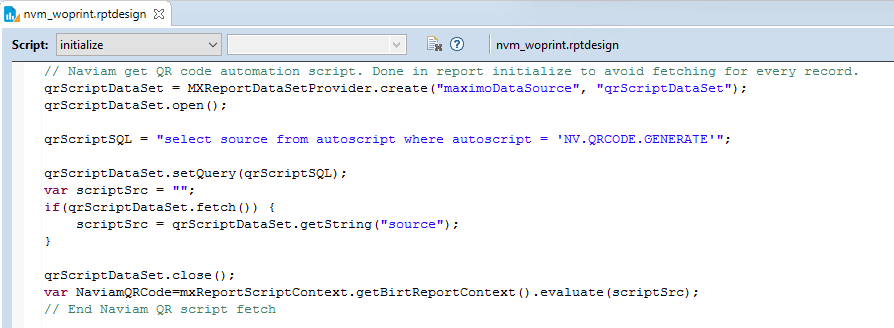
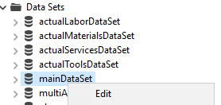
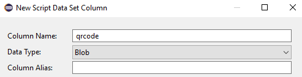
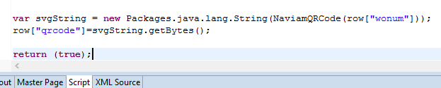
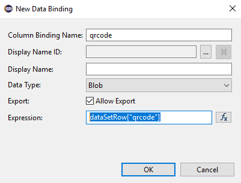
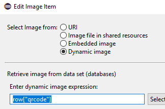
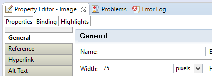
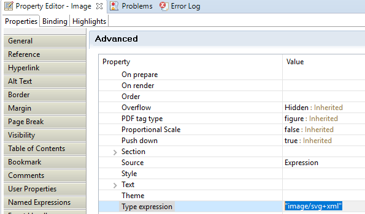

# Introduction
Customers have traditionally embedded bar codes (Code 39, Code 128, etc.) in BIRT reports. This required utilizing external services (sending data from your Maximo system to a third-party via webservice) or required deploying bar code fonts to the server. And depending on the barcode type, java libraries to encode the value properly. As QR codes have become more of an industry standard, we wanted to provide the ability to generate a QR code within a BIRT report without relying on any external services and without the complexity of deploying custom java libraries and/or fonts. 

# Install
The `NV.QRCODE.GENERATE` automation script must be deployed to your Maximo instance before a report can use it.

## Why a build is needed
The script is written in TypeScript (`src/qrcode-generate.ts` and `src/qrcode-generation.ts`) and uses the [qrcode-generator](https://www.npmjs.com/package/qrcode-generator) npm package to encode the QR code. Maximo and BIRT can only run plain JavaScript, in a single script with no access to npm packages. The build compiles the TypeScript to ES5 JavaScript, which Maximo's Nashorn engine and BIRT's Rhino engine can both run, and bundles the QR code library into the same file. The result, `dist/nv.qrcode.generate.js`, is the file that gets deployed to Maximo. The TypeScript sources are never deployed.

## Deploying with the VS Code extension (recommended)
The [Naviam Maximo Development Tools](https://marketplace.visualstudio.com/items?itemName=sharptree.maximo-script-deploy) VS Code extension builds and deploys in one step. Open this folder in VS Code, install the dependencies once with `npm install` (this requires [Node.js](https://nodejs.org/)), then deploy `src/qrcode-generate.ts` with the extension. The extension runs the build automatically and deploys the resulting `nv.qrcode.generate.js` to Maximo as `NV.QRCODE.GENERATE`, using the settings in the script's `scriptConfig` block. You do not need to run the build yourself.

## Building and deploying manually
Without the extension, build the script from a terminal. This requires [Node.js](https://nodejs.org/):

```bash
npm install
npm run webpack
```

This writes `dist/nv.qrcode.generate.js`. In Maximo, open the Automation Scripts application, create a script named `NV.QRCODE.GENERATE` without a launch point, and paste the full contents of that file as its source. Repeat the build and paste after any change to the TypeScript sources, because Maximo only runs what was last deployed.

`npm run webpack-dev` builds an unminified copy to `dist-dev/` and rebuilds it on every change, which is easier to read while debugging. Deploy the `dist/` build to production.

> Upgrading from `NAVIAM.QRCODE`: earlier versions of this library were deployed as `NAVIAM.QRCODE`. Existing reports keep working once the script name in their Report Initialize query is changed to `NV.QRCODE.GENERATE`. The `NAVIAM.QRCODE` script can then be removed.

The same script serves two purposes:
- In a BIRT report, evaluating its source returns a function that generates a QR code, as described below.
- As a web request, it returns a QR code image. See [Generating a QR Code over HTTP](#generating-a-qr-code-over-http).

# Adding a QR Code to a BIRT report

## Report Initialize
The first step is retrieving the script in the BIRT report. On the report initialize, add the script below. This is done in the report initialize to avoid fetching the script multiple times if being used on multiple records. This will create a global variable NaviamQRCode that we can utilize throughout the report to generate the QR code.

```javascript
qrScriptDataSet = MXReportDataSetProvider.create("maximoDataSource", "qrScriptDataSet");
qrScriptDataSet.open();

qrScriptSQL = "select source from autoscript where autoscript = 'NV.QRCODE.GENERATE'";
	
qrScriptDataSet.setQuery(qrScriptSQL);
var scriptSrc = "";
if(qrScriptDataSet.fetch()) {
	scriptSrc = qrScriptDataSet.getString("source");
}

qrScriptDataSet.close();
var NaviamQRCode=mxReportScriptContext.getBirtReportContext().evaluate(scriptSrc);
```




## Data Set
The next step is to define an Output Column in your BIRT Data Set. Right click the Data Set and choose Edit.



Switch to Output Columns and add a new column. In our example we will use qrcode for the Column Name. It is important that the type is set to Blob.



Click OK on that dialog and click OK to close the Edit Data Set dialog.

With the Data Set selected, click the Script tab and switch the event from open to fetch. Add the following code before the return (true)
```javascript
var svgString = new Packages.java.lang.String(NaviamQRCode(row["wonum"]));
row["qrcode"]=svgString.getBytes("UTF-8");
```

NOTE: You must replace the row["wonum"] with the appropriate column for your dataset (assetnum, itemnum, ponum, etc.)



### Options
`NaviamQRCode(value)` returns the QR code as SVG markup. An optional second argument changes how it is generated:

```javascript
NaviamQRCode(row["wonum"], { errorCorrection: "H", margin: 2 });
```

| Option | Description | Default |
| --- | --- | --- |
| `format` | `svg` returns the SVG markup as a string, `png` returns the PNG image as a byte array | `svg` |
| `scale` | Pixels per module (the black and white squares of the code), 1 to 40; sizes the image to the code | `8` |
| `width`, `height` | Image size in pixels, up to 4096; the code is fitted inside and centered. Giving one alone makes a square. Cannot be combined with `scale` | |
| `margin` | Width of the white border in modules, 0 to 20. The QR specification asks for at least 4 | `4` |
| `errorCorrection` | `L`, `M`, `Q` or `H`; higher levels survive more damage but make a denser code | `M` |

An invalid value or option, such as an empty value or one too long for a QR code, throws an error starting with `NaviamQRCode:`.

### PNG instead of SVG
Some report outputs render SVG images poorly. To use a PNG instead, return the bytes directly, since no string conversion is needed:

```javascript
row["qrcode"]=NaviamQRCode(row["wonum"], { format: "png", width: 200 });
```

When using PNG, set the image Type expression to "image/png" instead of "image/svg+xml" (see [Image control](#image-control)).

## Table Binding
The next step is to select the table and add a new Data Column Binding.

Name: qrcode

Data Type: Blob

Export: Allow Export checked

Expression: dataSetRow["qrcode"]



Click OK on that dialog.

## Image control
From the Palette, drag the Image control on the report where you want it to display. If this is going to be displayed in the header, you typically will want it in the Table Group Header (if one exists) rather than the Report Header. The Report Header will render on top of every page in the report but the QR code would be based on the first record in the result set. If you had work order 1001, 1002, and 1003 in a WOPRINT report, the QR code in the report header would display 1001 on each of the pages. 

The Table Group Header will group by the identifier (such as wonum & siteid for WORKORDER) and will display the desired QR code for each record. 

Select Image from: Dynamic image
Enter dynamic image expression: row["qrcode"]



On the Property Editor, in the General Tab, specify the desired width in pixels.



On the Property Editor, in the Advanced tab, scroll to the Type expression and set it to "image/svg+xml" (or "image/png" if you used the `png` format). ***This is critical or the QR code will not be visible in the report.***



# Generating a QR Code over HTTP
Outside of BIRT, the script returns a QR code image for a web request:

```
GET /maximo/oslc/script/NV.QRCODE.GENERATE?value=1001
```

The response is a PNG image by default. A POST encodes its request body instead of the `value` parameter, for values too long for a URL. The query parameters `format`, `scale`, `width`, `height`, `margin` and `errorCorrection` work as the options above, except that `format` defaults to `png`. An invalid request is answered with a 400 status and a JSON body describing the problem.

